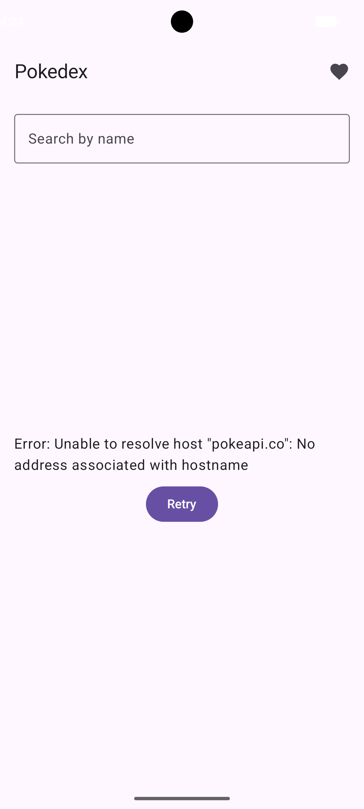
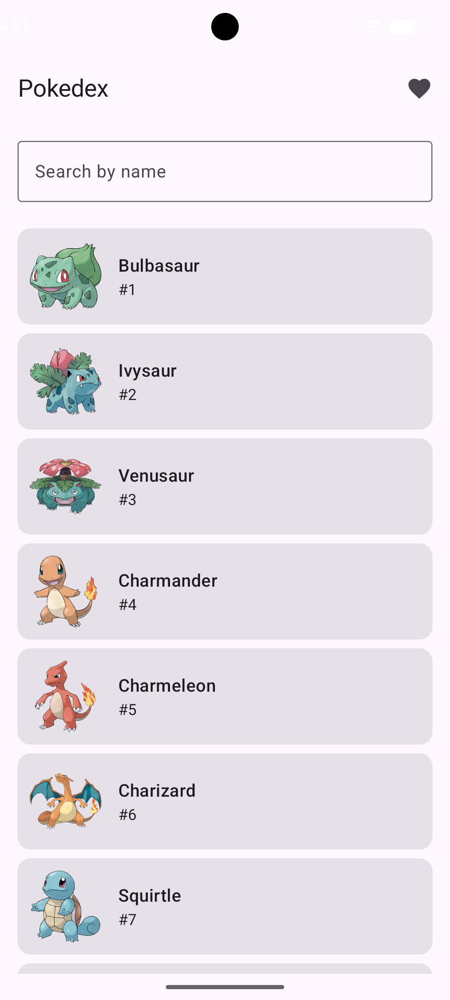
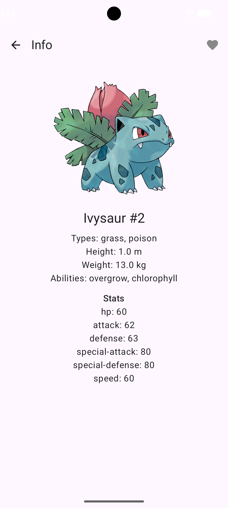

# Итоговый проект - Pokedex

**ФИО:** Лысенко Ангелина Константиновна.
**Группа:** Б9124-09.03.03пикд(4).

## Выбранный API
PokéAPI v2 — https://pokeapi.co/api/v2/ (ключ не нужен).

## Что даёт API
Данные о покемонах: список (первые 151), детали по id — типы, рост, вес,
способности и базовые характеристики. Встроенного поиска у API нет,
поэтому поиск по имени выполняется локально по загруженному списку.
На экране деталей покемона можно добавить в избранное, список избранного
находится на отдельном экране.

## Как запустить
1. Открыть проект в Android Studio.
2. Дождаться Gradle Sync.
3. Запустить на эмуляторе или устройстве. Нужен интернет.

## Скриншоты

